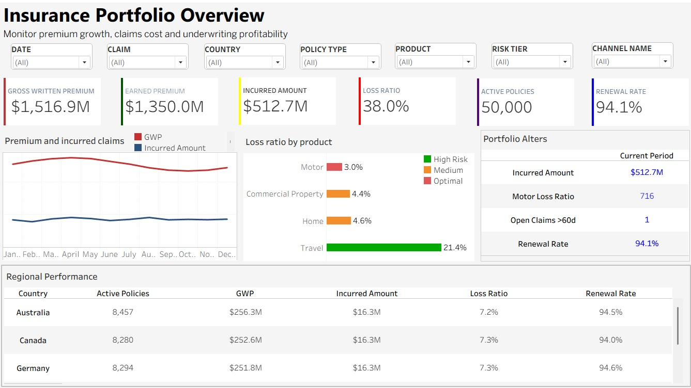
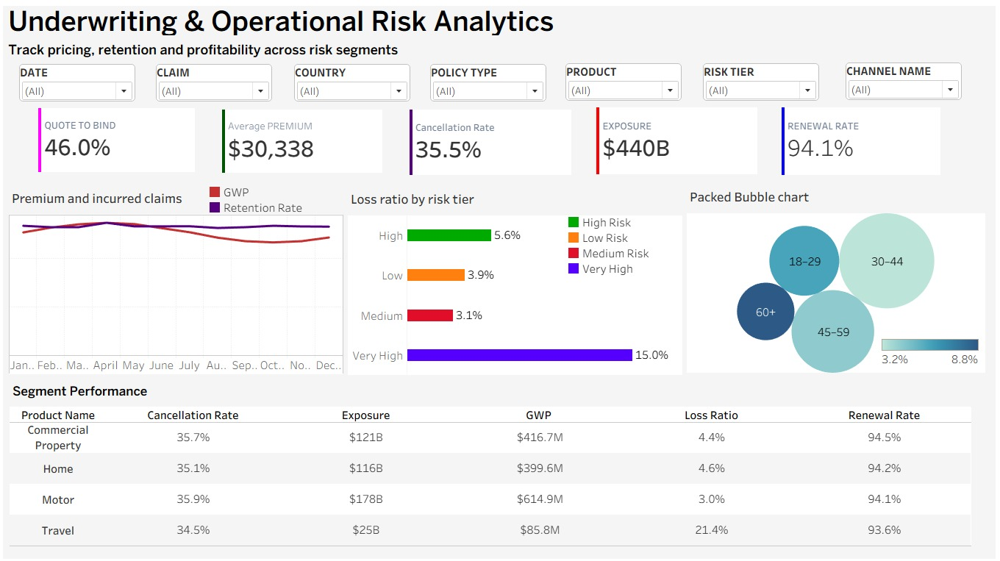
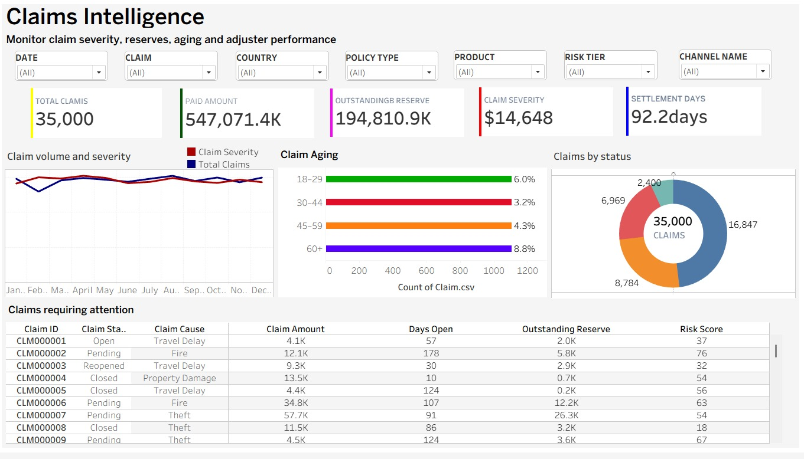
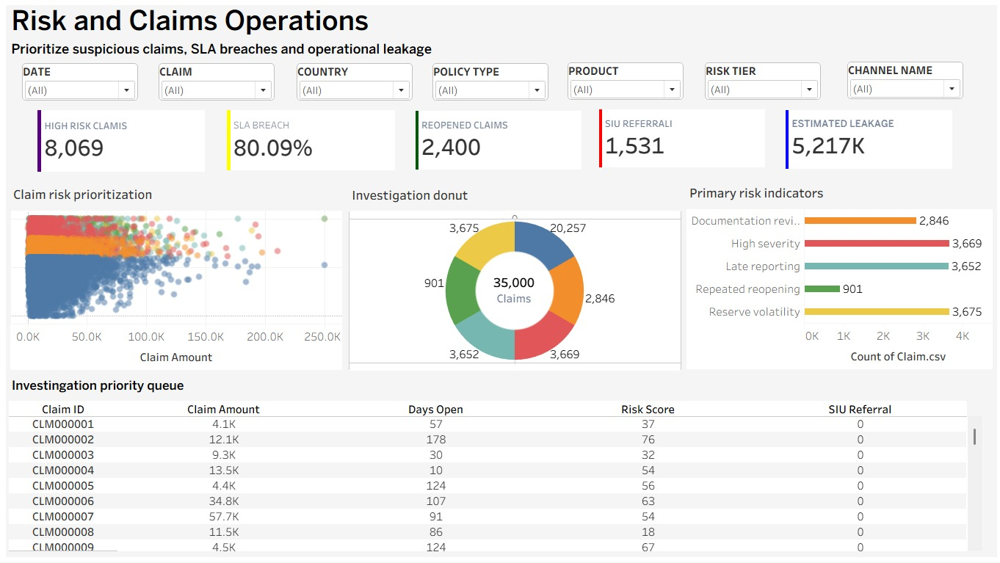

# Insurance Claims & Underwriting Intelligence | RUSA Analytics

**RUSA Analytics engagement · Tableau · Insurance analytics**

RUSA Analytics delivered a four-dashboard Tableau analytics engagement spanning insurance portfolio monitoring, underwriting and operational risk, claims intelligence, and risk and claims operations.

> **Disclosure:** RUSA Analytics has confirmed the engagement. The publicly shown dashboard figures use synthetic or illustrative values; they are not audited client KPIs or measured business outcomes. Client identities and internal delivery assets are not disclosed.

## Dashboard gallery

### 1. Insurance Portfolio Overview

Tracks written and earned premium, incurred claims, loss ratio, policies, renewals, product mix and geographic performance.

### 2. Underwriting & Operational Risk Analytics

Reviews quote-to-bind conversion, premium, cancellation, exposure, renewal and risk segments.

### 3. Claims Intelligence

Examines claim counts, paid amounts, reserves, severity, settlement times, claim aging and case queues.

### 4. Risk & Claims Operations

Surfaces operational risk indicators, SLA exceptions, reopened claims and special investigation unit (SIU) referrals. **Risk flags and SIU referrals are not proof of fraud.**

## Business questions addressed

- How do written premiums, earned premiums and incurred claims differ across portfolio segments?
- How do exposure, cancellations, renewals and quote-to-bind rates vary by risk tier?
- Which claim categories, statuses and aging bands deserve review?
- How can claims teams prioritize human-led operational exception management?

## Technology and data model

- **Visualization:** Tableau, four dashboard views
- **Filters:** Date, policy, claim, product, risk tier, geography and channel
- **Key modeling consideration:** Monthly policy snapshots and claim/payment transactions have different levels of detail. Validate aggregation and reconciliation to prevent double-counting.

## Delivery inventory and confidentiality

The related **internal OneDrive** folder `RUSA_INSURANCE_TABLEAU_PROJECT` contains a Tableau workbook (`RUSA_Insurance_Tableau_Analytics.twb`), original and cleaned data, developer handoff and business documentation, four dashboard screenshots, design assets and four videos. These materials are held for internal use and are **not publicly downloadable**.

This inventory confirms file presence, not successful independent execution or full QA of the workbook. Only approved dashboard screenshots and public documentation are included here.

## Discuss this engagement

Visit [RUSA Analytics](https://www.rusaanalytics.com/) to **book a discovery call** about adapting the analytics approach to your insurance workflows.

**RUSA Analytics | AI-Powered Insights. Business-Driven Outcomes.**
