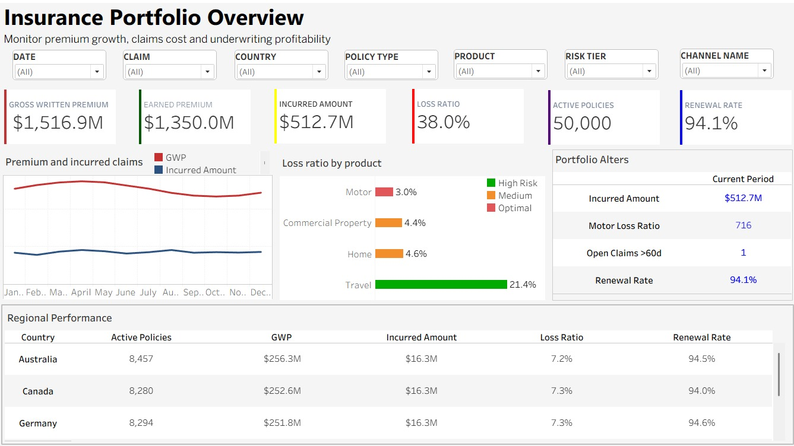
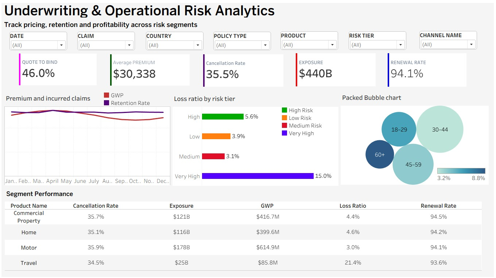
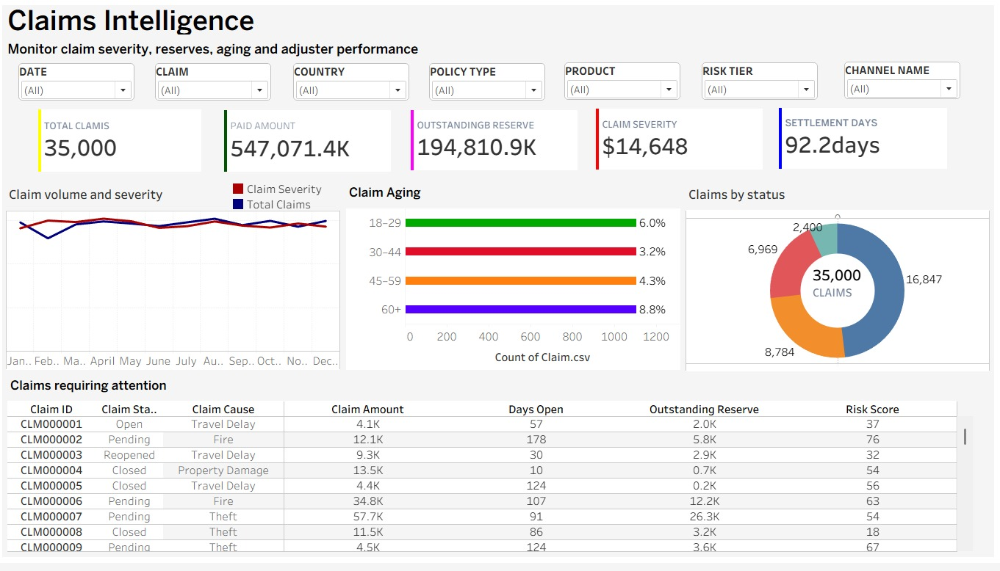
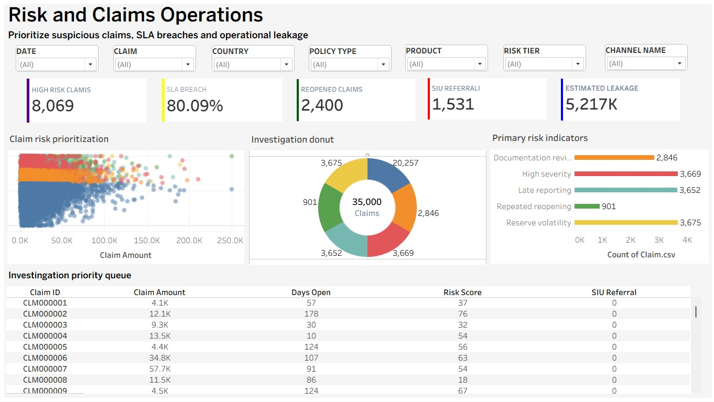

# Case Study: Insurance Claims & Underwriting Intelligence

**RUSA Analytics | Tableau | Insurance | Synthetic demonstration / proof of concept**

> **Disclosure:** This is a RUSA Analytics portfolio demonstration using synthetic insurance data, not a verified client deployment. Figures in the screenshots are illustrative. No real insurer's operational performance, actual savings, fraud findings, or investment returns are claimed.

## Executive summary

RUSA Analytics developed a four-dashboard Tableau proof of concept illustrating how insurance teams could analyze portfolio premiums, underwriting exposure, claims activity, and operational review priorities in one navigable experience. The dashboards support filtering by date, claim, country, policy type, product, risk tier, and channel.

## Business challenge

Insurance organizations need coherent views of premiums, policy populations, underwriting risk, claims, and case-management signals. Disconnected data definitions and different levels of detail can obscure loss ratios, claim aging, regional performance, and service exceptions. This demonstration explores how a consolidated Tableau view might help analytics and business teams navigate these challenges.

## Solution: four decision views

### 1. Insurance Portfolio Overview

Displays gross written premium, earned premium, incurred claims, loss ratio, active policies, renewal rate, trends, product comparisons, and regional performance.

### 2. Underwriting & Operational Risk Analytics

Explores quote-to-bind rate, average premium, cancellation rate, exposure, renewal rate, risk-tier loss ratios, and underwriting segment comparisons.

### 3. Claims Intelligence

Shows claims volume, paid amounts, outstanding reserve, severity, settlement days, claim age/status, and cases requiring attention.

### 4. Risk & Claims Operations

Presents high-risk claim flags, SLA breach rates, reopened claims, SIU referrals, estimated leakage, primary risk indicators, and an investigation queue. A referral or high-risk flag **does not establish fraud**.

## Selected synthetic values shown on dashboards

| Dashboard | Selected screenshot values |
| --- | --- |
| Portfolio | GWP **$1,516.9M**, earned premium **$1,350.0M**, incurred amount **$512.7M**, loss ratio **38.0%**, active policies **50,000**, renewal **94.1%** |
| Underwriting | Quote-to-bind **46.0%**, average premium **$30,338**, cancellation rate **35.5%**, exposure **$440B**, renewal **94.1%** |
| Claims | **35,000** claims, paid amount **547,071.4K**, outstanding reserve **194,810.9K**, severity **$14,648**, settlement time **92.2 days** |
| Operations | **8,069** high-risk claims, **80.09%** SLA breach, **2,400** reopened claims, **1,531** SIU referrals, estimated leakage **5,217K** |

**Metric validation caveat:** These are transcriptions of what the supplied screenshots show, not independently reconciled calculations. Units and relationships between premium, claims-paid, incurred, exposure, reserves and other measures require review before business use.

## Technology and data design

- Tableau dashboards and coordinated page-level filters.
- Synthetic data concepts described in the project handoff: Date, Customer, Product, Geography, Channel, PolicyMonthly, Claim, and ClaimTransaction.
- KPI cards, line trends, categorical comparisons, scatterplots, donut charts, and claim-level operational tables.
- Policy-month snapshots, claims, and claim transactions have different grains. Data modeling should prevent duplicated totals.

## Demonstrated capabilities

- Consolidate executive portfolio monitoring across premium, claims, and retention indicators.
- Compare product and risk-tier underwriting characteristics.
- Investigate claim aging, settlement trends, status mixes, and review queues.
- Support human-led triage of operational exceptions and risk indicators.

These are *potential analytical applications*, not measured business outcomes.

## Evidence, limits, and deployment readiness

The evidence is four actual screenshots provided by the dashboard developer and existing RUSA Analytics insurance project documentation. Screenshots substantiate the views' appearance, not end-to-end function, audited KPI correctness, customer adoption, production integration, or realized impact. Final packaged Tableau workbook and source CSV/data dictionary were not independently verified at publication.

Before operational deployment: verify KPI formulas and denominator choices, reconcile financial totals and claim counts, test filters and navigation, review access controls, and confirm data governance and privacy requirements.

## About RUSA Analytics

RUSA Analytics builds business intelligence, analytics, and decision-support solutions for enterprise teams.

**Website:** https://www.rusaanalytics.com  
**Repository:** https://github.com/RUSA-Analytics/insurance-claims-underwriting-intelligence
